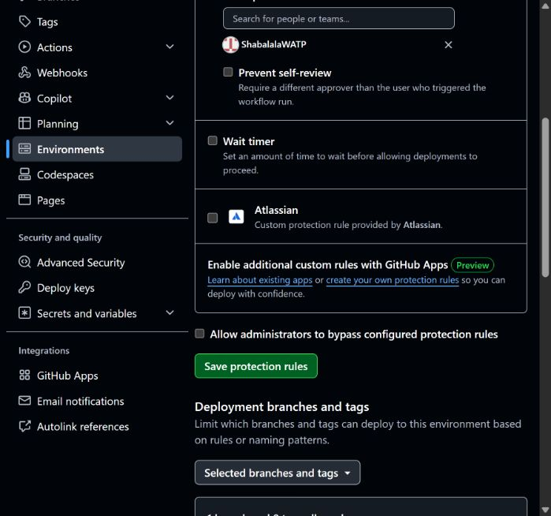

# KAN-225: production approval gate acceptance

Verified 11 October 2026, Europe/London. Alex explicitly approved the prepared
settings and approval/rejection of two harmless tests through the connected
`ShabalalaWATP` account. This was not approval of a VPS deployment.

## Effective settings

The `production` environment was read back after the REST reviewer update and
the browser save that disabled administrator bypass.

| Control | Verified value |
| --- | --- |
| Required reviewer | `ShabalalaWATP`, user ID `128953080` |
| Wait timer | No timer, zero minutes |
| Prevent self-review | `false`, the approved single-maintainer policy |
| Administrator bypass | `false` |
| Branch policy | Selected branches; exactly branch `main`, no tags |

The environment was preserved, with no changes to secrets or variables.
No production job was active when the settings changed. The existing
current-main/exact-tested-SHA selection, restricted SSH and controller checks
were unchanged.

## Live acceptance

Both runs used the already merged `.github/workflows/release-gate-check.yml`
at `e1eabc933d2d08bcc7540cad990292cf1a2f742a`, workflow ID `380679078`.
It has only a summary-writing step, a read-only token, no checkout, external
actions, secret references or production commands. The deployment workflow
watches `CI`, not this gate-check workflow.

| Case | Before decision | Decision and observed result |
| --- | --- | --- |
| [Approved check](https://github.com/ShabalalaWATP/AllSeeingEye/actions/runs/38099298139) | `waiting`, no job steps; required production reviewer reported by the pending-deployments API | Explicitly approved; `success`; the summary-writing step succeeded and the summary was visibly present. |
| [Rejected check](https://github.com/ShabalalaWATP/AllSeeingEye/actions/runs/38099332355) | `waiting`, no job steps; required production reviewer reported by the pending-deployments API | Explicitly rejected; expected `failure`; completed job had zero steps. |

GitHub records both review decisions as `ShabalalaWATP`; each comment names
KAN-225, Alex's authorisation and the no-deployment scope. They create GitHub
environment deployment records, not a VPS release. The most recent `Deploy VPS`
run remained [38071411506](https://github.com/ShabalalaWATP/AllSeeingEye/actions/runs/38071411506),
which stopped on 10 October at the manual migration/controller rollout guard.
Neither no-op check triggered another deployment.

## Boundaries and remaining work

Administrators can still edit the environment configuration. Credentials acting
as Alex can approve as Alex, and self-review is deliberately allowed. This is an
explicit release decision, not independent two-person approval. Agents must
obtain the applicable release authorisation before approving an actual release;
passing CI is not that authorisation.

KAN-225's live acceptance criteria are met. KAN-164's licence/offer decisions and
KAN-165's real operator details and exact-content publication approval remain
separate. Manual migrations and installation of reviewed deployment-controller
files also remain outstanding. No live host change or publication is claimed.
